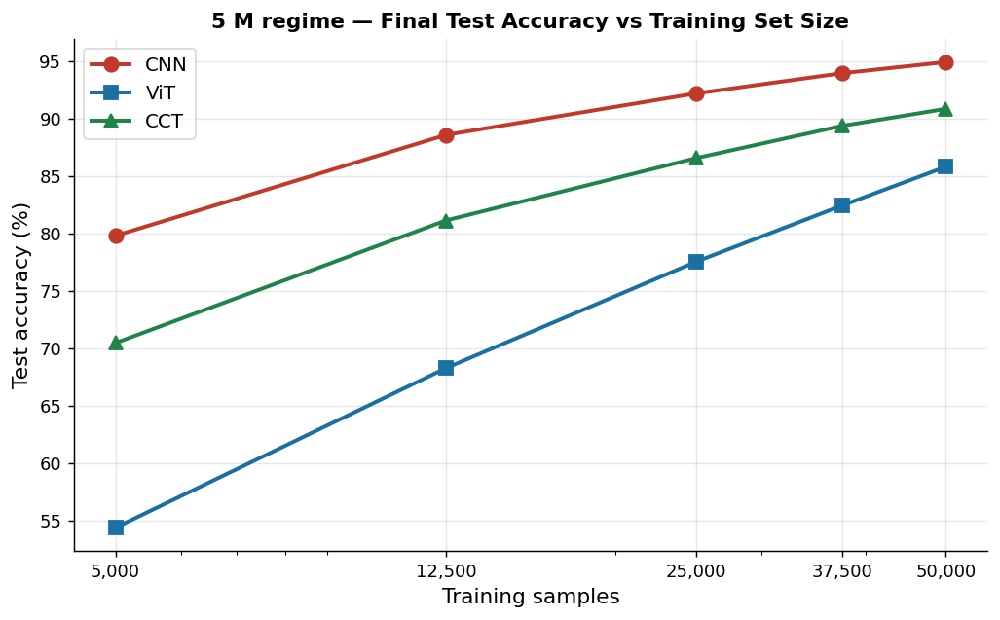
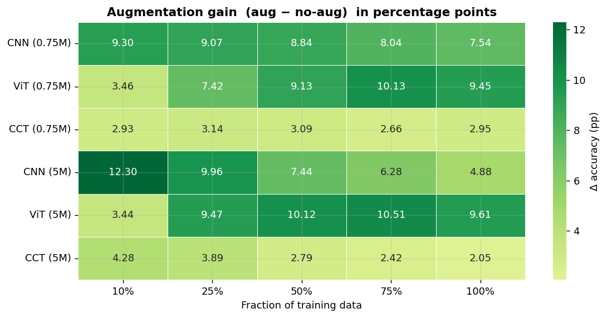

# Inductive Bias under Data Scarcity

**A parameter-matched comparison of CNN, Vision Transformer and Compact Convolutional Transformer architectures on CIFAR-10.**

Course project for *30562 Machine Learning and Artificial Intelligence*, Bocconi University (2026) · [Full report (PDF)](report.pdf)

<p align="center">
  
</p>

## Question

Convolutional networks hard-wire locality and translation equivariance; Vision Transformers learn spatial structure from data through global self-attention; Compact Convolutional Transformers put a convolutional tokenizer in front of the attention stack. How much does each of these inductive biases matter when data is scarce, once model capacity is held fixed?

## Approach

- **Six models, two capacity budgets.** A ResNet-style CNN, a ViT and a CCT, each at about 0.75M and about 5M parameters, matched within ±5% at each budget.
- **Controlled data scaling.** Every model trained from scratch for 150 epochs on nested subsets of CIFAR-10 (10%, 25%, 50%, 75%, 100%), with and without random crop and flip: 60 runs under an identical optimisation protocol.
- **Representation analysis.** Centred kernel alignment (CKA) within and across architectures, layer-wise linear probes, mean attention distance per head, and gradient-based effective receptive fields.

## Key findings

- **The CNN dominates the ViT at every data scale.** At ~5M parameters the gap narrows from 25.4 points at 10% of the data to 9.1 points at full data, but never closes.
- **The CCT is the most parameter-efficient model.** At ~0.75M parameters it closes the gap with the CNN and marginally surpasses it at full data (89.65% vs. 89.27%).
- **Augmentation helps the CNN most at low data, and the ViT most at high data.** At 10% of the data the CNN gains +12.3 points from random crop and flip versus +3.4 for the ViT; at full data the ranking reverses. The CCT's gain stays flat at 2–4 points, consistent with its convolutional tokenizer already encoding the relevant invariances.
- **Representations differ structurally.** The CCT sits between the CNN and the ViT in representational similarity, and the ViT builds global receptive fields only progressively across blocks.

<p align="center">
  
</p>

## Results

Test accuracy (%) after 150 epochs, with augmentation:

| Model | 10% | 25% | 50% | 75% | 100% |
|---|---:|---:|---:|---:|---:|
| CNN, 5M | 79.80 | 88.57 | 92.18 | 93.94 | **94.91** |
| ViT, 5M | 54.40 | 68.28 | 77.53 | 82.43 | 85.80 |
| CCT, 5M | 70.47 | 81.13 | 86.55 | 89.36 | 90.84 |
| CNN, 0.75M | 77.40 | 83.41 | 87.07 | 88.28 | 89.27 |
| ViT, 0.75M | 53.73 | 65.52 | 74.08 | 79.58 | 82.60 |
| CCT, 0.75M | 68.11 | 79.19 | 84.90 | 87.62 | **89.65** |

Results without augmentation and all ablations are in the [report](report.pdf).

## Repository structure

```
.
├── analysis.ipynb          Analysis notebook: loads the saved results and produces every figure and table
├── report.pdf              Project report (main text and appendix)
├── models/                 One script per architecture ({cnn,vit,cct}_{small,large}_script.py)
├── training_scripts/
│   └── train_hpc.py        Training entry point used on the GPU cluster
├── parameters_aug/         30 trained checkpoints (.pt), with augmentation
├── parameters_noaug/       30 trained checkpoints (.pt), without augmentation
├── resultsxepochs_aug/     Per-epoch loss and test accuracy (JSON), with augmentation
├── resultsxepochs_noaug/   Per-epoch loss and test accuracy (JSON), without augmentation
└── assets/                 Figures used in this README
```

CIFAR-10 is not stored in the repository; `torchvision` downloads it on first use.

## Reproducing the analysis

```bash
git clone https://github.com/trozki213/cnn-vit-cct-comparison.git
cd cnn-vit-cct-comparison
python -m venv .venv && source .venv/bin/activate
pip install -r requirements.txt
jupyter notebook analysis.ipynb
```

The notebook is decoupled from training: accuracy tables, learning curves and augmentation gains are read from the JSON logs, and CKA, probes, attention distances and receptive fields from the saved checkpoints. Everything runs on a CPU in minutes.

## Retraining from scratch (GPU)

```bash
python training_scripts/train_hpc.py --model cnn_large --augment     # or --no-augment
```

This trains one architecture on all five data fractions for 150 epochs each. Valid `--model` values are `{cnn,vit,cct}_{small,large}`. The protocol is identical for all models: AdamW (peak learning rate 1e-3, weight decay 5e-2), linear warm-up then cosine annealing, batch size 256, label smoothing 0.1, gradient clipping at norm 1.0, mixed precision, seed 0.

## Authors

Victor Antonescu, Letizia Di Pietro, Martin Lukanov, Alexandru Stoica, Antonio Troiano (Bocconi University).
